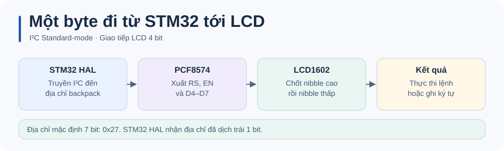

# STM32 LCD I²C · LCD1602 qua PCF8574

Thư viện C điều khiển **LCD1602 tương thích HD44780** qua backpack **PCF8574**, với demo đếm số trên STM32F103C8T6. Dữ liệu đi qua I²C1 ở 100 kHz, sau đó backpack điều khiển LCD ở chế độ 4 bit.


## Đấu dây

| Blue Pill | Backpack | Vai trò |
| --- | --- | --- |
| PB6 | SCL | Xung I²C1, open-drain |
| PB7 | SDA | Dữ liệu I²C1, open-drain |
| GND | GND | Mass chung |
| Nguồn theo module | VCC | Theo yêu cầu của LCD và backpack |

Nếu dùng module 5 V, dùng bộ dịch mức I²C hai chiều với pull-up phù hợp ở phía 3,3 V và phía 5 V. Một backpack có thể kéo SDA/SCL lên chính VCC. Đối chiếu điện áp và pin map trước khi cấp nguồn. [Datasheet PCF8574](https://www.ti.com/lit/ds/symlink/pcf8574.pdf)

## Build và nạp firmware

Cần **Python 3.9+**, **GNU Arm Embedded** (`arm-none-eabi-gcc`, `objcopy`, `size`) và gói **STM32CubeF1 v1.8.7**. Script dùng HAL và startup từ gói ST, cùng linker script 64 KiB flash / 20 KiB SRAM của STM32F103C8.

```sh
python build.py
```

Đặt GNU Arm Embedded vào `PATH`, hoặc chỉ định thư mục `bin` của toolchain. Nếu gói HAL nằm ngoài thư mục mặc định `~/STM32Cube/Repository/STM32Cube_FW_F1_V1.8.7`, truyền đường dẫn tới thư mục chứa `Drivers`.

```sh
python build.py --sdk "<STM32CubeF1 root>" --toolchain "<GNU Arm bin>"
```

Build tạo `build/firmware.elf`, `build/firmware.hex` và `build/firmware.bin`. Nạp `.hex` bằng STM32CubeProgrammer qua ST-LINK/SWD, rồi reset board. Có thể dùng `.elf` để nạp symbol và debug. Firmware mẫu dùng HSE 8 MHz và SYSCLK 72 MHz.

Tài liệu công cụ: [STM32CubeF1](https://github.com/STMicroelectronics/STM32CubeF1) · [STM32CubeProgrammer](https://www.st.com/en/development-tools/stm32cubeprog.html).

## Chạy thử

Sau khi nạp firmware, hàng đầu hiển thị `Counter:`; hàng thứ hai bắt đầu từ 0 và tăng sau mỗi khoảng nửa giây. Nếu đèn nền sáng nhưng chữ không hiện, chỉnh biến trở tương phản và kiểm tra địa chỉ 7 bit của backpack.

## Tích hợp thư viện

Thêm [`lcd_i2c.c`](Core/Src/lcd_i2c.c) và [`lcd_i2c.h`](Core/Inc/lcd_i2c.h) vào project STM32F1 HAL. Trong CubeMX bật I2C1, chọn PB6/PB7, Standard-mode 100 kHz và 7-bit addressing. Khởi tạo I²C trước LCD.

```c
LCD_Init(&hi2c1);
LCD_SetCursor(0, 0);
LCD_SendString("STM32 LCD");
```



| API | Công dụng |
| --- | --- |
| `LCD_Init(&hi2c1)` | Gắn handle và khởi tạo LCD ở chế độ 4 bit. |
| `LCD_Clear()` | Xóa màn hình. |
| `LCD_SetCursor(row, col)` | Hàng 0 hoặc 1, cột 0–15. |
| `LCD_SendString(str)`, `LCD_SendChar(ch)` | Ghi văn bản hoặc ký tự. |
| `LCD_Backlight(0 hoặc 1)` | Tắt hoặc bật đèn nền. |

Địa chỉ 7 bit mặc định là `0x27`; macro `LCD_I2C_ADDR` lưu dạng dịch trái một bit cho HAL. Đổi macro ở build hoặc header nếu module dùng địa chỉ khác. Thư viện dùng pin map backpack `P0=RS, P1=RW, P2=EN, P3=backlight, P4–P7=D4–D7`. Các hàm giao tiếp blocking và dùng một handle LCD; nếu cần chẩn đoán bus, thử `HAL_I2C_IsDeviceReady()` trước khi gọi `LCD_Init()`.

## Giấy phép

MIT, theo khai báo của dự án.
