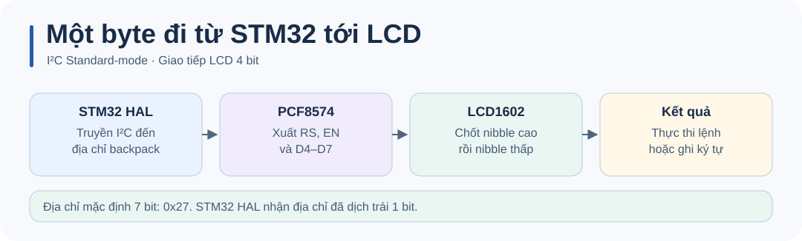

# STM32 LCD I²C · Hướng dẫn kỹ thuật

Xem [README](../README.md) để đấu dây, build và chạy thử.

## Cấu hình

Thêm [`lcd_i2c.c`](../Core/Src/lcd_i2c.c) và [`lcd_i2c.h`](../Core/Inc/lcd_i2c.h) vào project STM32F1 HAL. Trong CubeMX bật I2C1, chọn PB6/PB7, Standard-mode 100 kHz và 7-bit addressing. Khởi tạo I²C trước LCD.

```c
LCD_Init(&hi2c1);
LCD_SetCursor(0, 0);
LCD_SendString("STM32 LCD");
```

## Luồng hoạt động



| API | Công dụng |
| --- | --- |
| `LCD_Init(&hi2c1)` | Gắn handle và khởi tạo LCD ở chế độ 4 bit. |
| `LCD_Clear()` | Xóa màn hình. |
| `LCD_SetCursor(row, col)` | Hàng 0 hoặc 1, cột 0–15. |
| `LCD_SendString(str)`, `LCD_SendChar(ch)` | Ghi văn bản hoặc ký tự. |
| `LCD_Backlight(0 hoặc 1)` | Tắt hoặc bật đèn nền. |

Địa chỉ 7 bit mặc định là `0x27`; macro `LCD_I2C_ADDR` lưu dạng dịch trái một bit cho HAL. Đổi macro ở build hoặc header nếu module dùng địa chỉ khác. Thư viện dùng pin map backpack `P0=RS, P1=RW, P2=EN, P3=backlight, P4–P7=D4–D7`. Các hàm giao tiếp blocking và dùng một handle LCD; nếu cần chẩn đoán bus, thử `HAL_I2C_IsDeviceReady()` trước khi gọi `LCD_Init()`.

## Kiểm tra và chẩn đoán

Nếu đèn nền sáng nhưng chữ không hiện, chỉnh biến trở tương phản và kiểm tra địa chỉ 7 bit của backpack. Dùng `HAL_I2C_IsDeviceReady()` để kiểm tra phản hồi trước khi gọi `LCD_Init()`.
